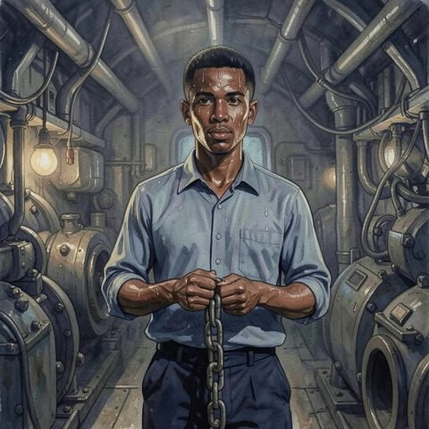
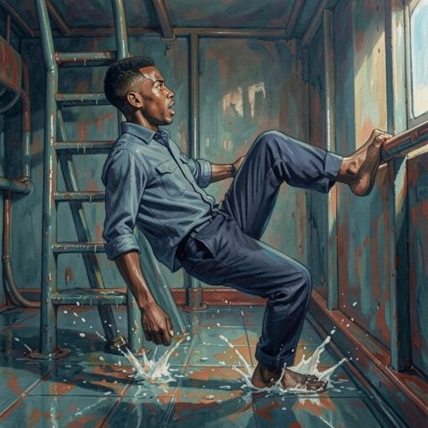
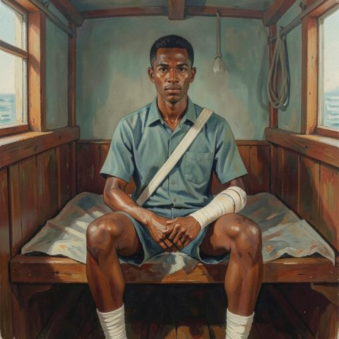
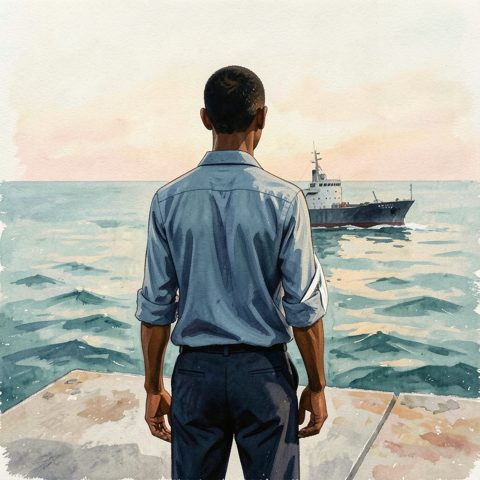
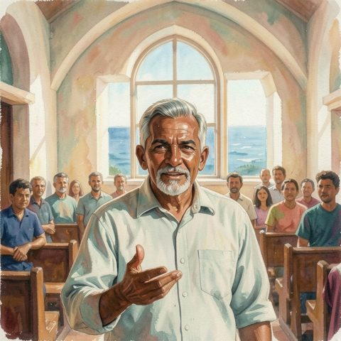
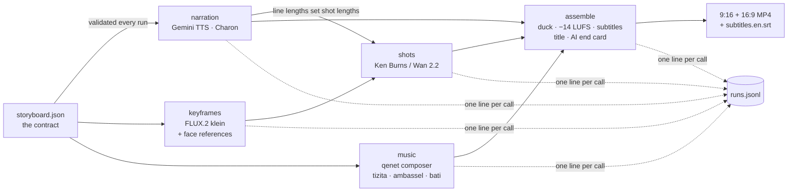

# ሐሙስ · Thursday

> *In 1982 E.C. my uncle, a young sailor in the Ethiopian Navy, slipped inside his ship on a Tuesday and broke his arm.
> His commander told him to stay behind. On Thursday the ship sailed to Massawa without him, and it was sunk in an attack by Eritrean fighters.
> On Friday he heard the news. He calls it the day he was born again. Today he is a preacher who tells everyone:
> **ሕይወትህን እግዚአብሔር ይምራው**, let God lead your life.*

This repository is a small film studio in code that turns that story into an **88-second Amharic short film** with English
subtitles, an original score, and both vertical (9:16) and horizontal (16:9) exports. Every image, line of narration and
note of music comes from one file, [`storyboard.json`](storyboard.json). Change one sentence in it and only that shot
is remade.

<p align="center">
  
  
</p>

**🎬 Film:** [9:16](#) · [16:9](#) *(links added after posting)* · **📜 The ship's log** (every shot, with the models, seeds and scores that made it): **[jobnovice.github.io/heritage-short](https://jobnovice.github.io/heritage-short/)**

---

## Contents
1. [Run it in three commands](#run-it-in-three-commands)
2. [How the studio works](#how-the-studio-works)
3. [Follow one sentence through the pipeline](#follow-one-sentence-through-the-pipeline)
4. [A five-minute tour](#a-five-minute-tour)
5. [Decisions worth arguing about](#decisions-worth-arguing-about)
6. [What broke](#what-broke)
7. [For other filmmakers and their agents](#for-other-filmmakers-and-their-agents)
8. [FAQ](#faq)
9. [The documents](#the-documents)

---

## Run it in three commands

You need Python 3.11+, FFmpeg (`brew install ffmpeg`), a free [Gemini API key](https://aistudio.google.com) and a free
[Cloudflare](https://dash.cloudflare.com) account (Workers AI token). Nothing here needs a payment card.

```bash
git clone https://github.com/jobnovice/heritage-short && cd heritage-short
make setup     # creates .venv, installs deps, copies .env.example -> .env  (put your keys there)
make film      # -> outputs/final/thursday_9x16.mp4 and thursday_16x9.mp4
```

| Command | What it does | Calls models? |
|---|---|---|
| `make smoke` | pings every provider once, logs latency, lists the Gemini models your key can see | yes, 1 each |
| `make validate` | schema + semantic checks on the storyboard | no |
| `make plan` | **predicts** what `make film` would regenerate, like `terraform plan` | no |
| `make radio` | the prototype: narration + score on a black screen | TTS only |
| `make film` | the whole film; only what changed is regenerated | only for changes |
| `make test` | 19 offline tests (contract, single-shot caching, timing, retries, music) | no |
| `make costs` | rebuilds the measured tables in COSTS.md from `runs.jsonl` | no |
| `make showcase` | rebuilds the ship's-log page in `docs/` | no |

---

## How the studio works



Five stages read one contract. Each output carries a `.meta.json` sidecar with a hash of exactly the inputs that made it,
including the stage's own source code, so `make film` regenerates only what is out of date. Every model call, retry, fallback
and quota error is one line in [`runs.jsonl`](runs.jsonl). The full design (contracts, cache keys, fallback chains,
quality gates) is in [ARCHITECTURE.md](ARCHITECTURE.md).

**The unusual parts**
- **The score is composed in code, not generated.** Ethiopian music is built on *qenet*, pentatonic modes with emotional
  meaning. The film opens in **tizita** (the mode of longing), turns to **ambassel** for the fall, goes **silent** at the
  sinking, and brings the Massawa theme back in **bati major** for the rebirth. It is deterministic and original, and it
  needs no GPU ([`pipeline/music.py`](pipeline/music.py)).
- **The film is checked by listening to itself.** Each narration take is transcribed back by a speech model and scored
  against the script. That caught the TTS model reading its own instructions aloud (FAILURES F7).
- **Faces come from a reference, not from luck.** A head-and-shoulders crop of each character sheet conditions every
  shot, and the older uncle is drawn *from* the young uncle's face. Four rounds of experiments got there (E11-E13).

---

## Follow one sentence through the pipeline

Take shot **s05**, the cost of the fall:

```jsonc
// storyboard.json
{ "id": "s05", "beat": "Tuesday", "shot_size": "medium_close", "duration_sec": 5,
  "reason": "The cost of the fall, shown plainly: the sling and bandage are the motif that returns at the dock.",
  "characters": ["uncle_young"],
  "image_prompt": "{uncle_young} sitting on a narrow ship bunk, his right arm in a white sling ...",
  "motion": { "camera": "push_in" },
  "narration": { "am": "ቁርጭምጭሚቱ ተጣመመ፤ ክንዱም ተሰበረ።", "en": "His ankle twisted. His arm broke." } }
```

1. **validate**: the schema demands a `reason`, a camera move (so a fallback always exists) and both languages; `uncle_young` must exist and, being a real person, must point to a consent record.
2. **narration**: the Amharic line goes to Gemini TTS → `outputs/narration/s05.wav` (3.92 s). The sidecar keeps the duration (and an ASR score when `--verify` ran).
3. **keyframes**: `{uncle_young}` expands to his fixed description, the style block is appended, and his face crop is sent as `input_image_0` → `s05.png`.
4. **shots**: duration = max(5 s, 3.92 s + 0.4 s lead-in + 0.5 s tail) = 5 s; a slow push-in over the keyframe → `s05.mp4`.
5. **assemble**: the voice lands at 0.4 s into the shot, the score ducks under it, and the subtitle card *"His ankle twisted. His arm broke."* is drawn by Pillow inside the vertical safe area.

Change that Amharic line and run `make plan`:
```
narration:
  + s05                  regenerate
shots:
  ~ s05                  maybe (re-timed if the new line is longer than duration_sec)
music: maybe (re-timed)
edit:  regenerate (mix + both renders)
Plan: 1 model call(s) would be made. Nothing has been called.
```

---

## A five-minute tour
1. Read the storyboard's `reason` fields top to bottom: that's the film's argument, shot by shot.
2. `make plan` on a clean clone of the outputs → `0 model calls`.
3. Open [`runs.jsonl`](runs.jsonl) and search for `"status": "rejected_too_long"`: those are the takes where the voice read its prompt aloud, caught and retried.
4. Skim [EXPERIMENTS.md](EXPERIMENTS.md) E5 (style prompts), E6 (Gemini vs Addis AI) and E12 (pose leaking through references).
5. Open the ship's log ([live page](https://jobnovice.github.io/heritage-short/)) for the same story told as data.

---

## Decisions worth arguing about

| Decision | Why | What it cost |
|---|---|---|
| Plain stages around one JSON contract, no agent framework | The pipeline is linear; a graph of agents would add failure modes, not capability | Less impressive diagram |
| Ken Burns instead of Wan 2.2 video | Every shot moves slowly anyway; GPU queues would spend the day on 5-second clips | Less motion; Wan clips plug in via `motion.use_video` |
| Score composed in code instead of ACE-Step | Deterministic, original, culturally specific, zero GPU; the qenet *are* the story's emotional map | No orchestral richness |
| Gemini Charon narrates, not Addis AI | Family asked for a man's voice; Addis exposes no documented male voice (E14) | Gemini's per-model daily quota (F8) |
| The cause of the sinking is named | First draft stayed neutral; the family's telling names it, and it is their story (DESIGN) | Less neutral for some viewers |
| No in-text style prompts for TTS | They were spoken aloud on 8/11 lines (E5) | Less control over delivery |

---

## What broke
Eleven entries in [FAILURES.md](FAILURES.md). The ones that taught the most:
- **F4:** the cache served a stale video after a renderer fix. *Code is an input.*
- **F7:** Gemini TTS read the English style instruction aloud, and only on some lines. A duration guard and an ASR round trip now catch it.
- **F8:** the Gemini TTS free quota is **per model, per day**. A model chain (3.8 → 3.1-preview → 3.8-lite → 2.5) keeps the run going.
- **F10:** the words "gore, blood" in a FLUX prompt meant *avoid* to me and *draw* to the model, and they tripped the safety filter.

---

## For other filmmakers and their agents
- **MCP server:** `pipeline/mcp_server.py` exposes `plan`, `explain_shot`, `edit_shot` (validated before writing) and `render`.
  Claude Code picks it up from [`.mcp.json`](.mcp.json); any MCP client can run `python -m pipeline.mcp_server`.
- **Make your own film:** replace `storyboard.json` (keep the schema), delete `outputs/`, run `make film`.
- **Blind voice benchmark:** `python -m pipeline.benchmark render` makes loudness-matched A/B/C clips of three Amharic voices; `score` tallies the votes.

---

## FAQ
**I have no Cloudflare account.** Keyframes fall back to Pollinations (free, slow, watermarked), then to placeholder cards. The film still builds.
**My Gemini quota ran out.** Narration walks the model chain, then keeps the previous take and logs a fallback. Quotas reset at midnight Pacific.
**Why are there no MP4s in the repo?** They're 31 MB each and fully regenerable; the films are linked above. The `.meta.json` sidecars stay in git.
**Is the same seed the same image?** Not on hosted FLUX (E2). The cache is what makes a run reproducible.
**What did it cost?** $0.00. Measured latency per stage, the failure classes and a list-price equivalent are in [COSTS.md](COSTS.md).

---

## The documents
| File | What's in it |
|---|---|
| [DESIGN.md](DESIGN.md) | audience, intent, the days-of-the-week structure, user tests and what they changed |
| [ARCHITECTURE.md](ARCHITECTURE.md) | stages, contracts, cache keys, fallback chains, quality gates |
| [EXPERIMENTS.md](EXPERIMENTS.md) | 15 experiments: hypothesis → change → result → decision |
| [FAILURES.md](FAILURES.md) | what broke, what I tried, what fixed it |
| [COSTS.md](COSTS.md) | measured latency, failure counts, list-price equivalent (generated from logs) |
| [ETHICS.md](ETHICS.md) | consent, licences of every model and output, AI labelling |
| [docs/consent_form.md](docs/consent_form.md) | the bilingual consent form and voice-note script |

*Made with AI: images, voice and music were generated by the models listed in ETHICS.md. Built with a coding agent under my direction. In memory of the comrades who did not return.*
